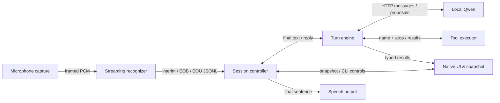
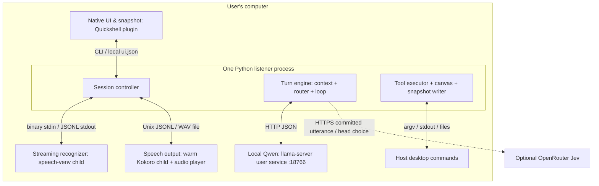
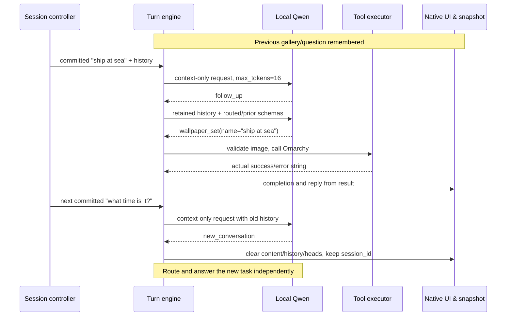

# Agavai: architecture and implementation design

Agavai (AGGAWAII in the request) turns a spoken request into a local desktop action.
This design explains where to place code, who owns state, and what crosses each
boundary. [Open the interactive diagrams](index.html) for component deployment and
arrow contracts.

Source baseline: `48f49b3`, inspected 2026-10-09. This describes the implemented
assistant, not the installed desktop or future evaluation capabilities.
[flow.md](../flow.md) governs runtime behavior; [audio.md](../audio.md) and
[ui-design.md](../ui-design.md) govern recognition and presentation. Their current
contracts supersede older Voxtype/GTK descriptions in architecture.md.

## Requirements

1. Show revisable speech before acting. Only nonempty end of utterance (EOU) or
   Enter commits a model turn; partials, silence and end of boundary (EOB) do not.
2. Execute only named desktop functions. The model proposes calls; the dispatcher
   runs them and returns results. Never infer action success from model intent.
3. Keep a listening session until dismissal. Related requests retain conversation
   and results; unrelated requests reset conversation inside that same session.
4. Use one native surface for speech, results and controls. Compact mode releases
   focus. A newly published canvas opens; retained snapshots preserve minimization.
5. Keep recognition, the assistant GGUF, speech and execution local. Default Jev
   routing can send committed text to OpenRouter; keyword routing removes that hop.

The workload is one person and serial voice turns. There is no measured end-to-end
latency SLA. Request timeouts are failure limits, not response-time objectives.

## High-level design

### Responsibilities



The **Session controller** owns turn ordering and cancellation. The **Streaming
recognizer** owns signal/model state. The **Turn engine** resolves context and
coordinates the model/tool loop. **Local Qwen** performs inference but never
executes an action. The **Tool executor** resolves proposed names through the
global `DISPATCH` allowlist. The **Native UI & snapshot** preserves actionable
screen data; **Speech output** receives the final readable reply.

The controller pauses capture before model work and playback, then reopens it with
the same reset ASR worker. There is no microphone barge-in during speech. The
controller, turn engine and tool executor share a Python process.

### Process boundaries



Qwen is supervised by `agavai-llm.service`, in its own cgroup. The plugin and model
service outlive a listener. ASR ends with the session; Kokoro can remain warm and
exits after its 600-second idle accept timeout. There are no application containers.

### Decisions and tradeoffs

| Choice | Why it fits | Cost and alternative |
| --- | --- | --- |
| ASR → Qwen → TTS cascade | Focused models fit the documented desktop budget. | Serial handoffs add latency. The historical v2 evaluation did not find a fitting single speech-and-tools replacement. |
| Learned EOU commits | Live text and model-driven sentence boundary; packet ends and RMS are not timing policy. | Cache/reset alignment matters. File transcription is simpler but returns words only after stop; silence/VAD endpointing can commit a pause. |
| Session-scoped controller | Clear microphone/context lifetime and cleanup. | ASR loads per new session. A resident agent needs broader ownership/coordination. |
| Selected tool heads | Limit schema context for the small GGUF. | Routing can miss a capability. Keyword routing is local but lexical; Jev adds a remote text hop. |
| Direct tool functions | Reuse the allowlist with no MCP hop inside voice turns. | Caller and tools share trust; no isolation or transaction rollback. MCP remains an external adapter. |
| Atomic latest snapshot | One complete current view for QML. | No event replay; typed and voice writers can collide. |

Assumptions: the configured GGUF can emit OpenAI tool calls (or Qwen `<tool_call>`
JSON), the Omarchy shell can load/summon the plugin, and supported desktop commands
are installed. Shell failure prevents listener startup. ASR failure ends listening.
Routing degrades to keywords, speech to eSpeak/notification; local HTTP errors do
not have a retry policy. These choices preserve explicit failure rather than
fabricating speech or successful actions.

### State lifetimes

| Lifetime | Owner | Reset condition |
| --- | --- | --- |
| Session: listener identity, cancellation and ordering | `listen_session`; ChatUi session UUID | Dismissal, capture failure or session exit |
| Utterance: overlap, caches, decoder tokens and current hypothesis | ASR worker; parent hypothesis | Acknowledged worker reset after commitment/stop |
| Conversation: model messages, inherited heads and results | Turn engine + ChatUi memory | Valid `new_conversation`, fresh session or process exit |
| Presentation: compact state, selection and preview | QML | New session/display or explicit UI interaction |

`session_id` survives a topic change so dismissal remains authoritative.
`display.id` is a different identity: publishing results creates a new id so the
canvas opens even when the new result contents resemble the previous ones.

## Modules

### Session controller

**Code:** [__main__.py](../../src/agavai/__main__.py),
[app.py](../../src/agavai/app.py), [state.py](../../src/agavai/state.py).

- **Deployment/lifecycle:** detached system-Python listener; guard startup with
  exclusive lock and identity-checked PID/start token. Own capture, ASR and ChatUi;
  commit, invoke engine, play reply, resume, then clean up on exit.
- **Protocol/configuration:** ASR events and CLI stop/cancel; runtime directory
  holds state, PID, lock and cancellation markers. Automatic invocation always
  selects streaming listen.
- **Performance/throughput:** one serial voice turn; ASR ready handshake 120 s.
  Blocking calls can delay cancellation; no end-to-end SLA.
- **Observability:** coarse state and snapshot phase. Direct stderr shows errors,
  but detached invocation discards stdout/stderr.

### Streaming recognizer and microphone capture

**Code:** [asr.py](../../src/agavai/asr.py),
[parakeet_worker.py](../../src/agavai/parakeet_worker.py).

- **Deployment/lifecycle:** per-utterance `parec`; per-session speech-venv ASR child.
  Continuous frontend/encoder/decoder state clears only on reset.
- **Protocol/configuration:** 16 kHz mono s16le, four-byte big-endian byte length;
  zero length flushes/resets. JSONL `{kind,text}` output. `[asr]` selects model dir,
  venv and CPU/optional NVIDIA CUDA.
- **Performance/throughput:** one stream, 160 ms new-feature steps, one ONNX
  intra-op thread; upstream design latency is not measured desktop latency.
- **Observability:** partial/error events, bounded stderr buffer and real fixture
  replays. No provider/timing metrics in the snapshot.

### Turn engine, context and routing

**Code:** [orchestrator.py](../../src/agavai/orchestrator.py),
[router.py](../../src/agavai/router.py), [heads.py](../../src/agavai/heads.py).

- **Deployment/lifecycle:** in caller process. Health → context → heads → bounded
  completion/dispatch loop → final reply. Keep up to 24 non-system messages.
- **Protocol/configuration:** `run_turn(text,cfg,ui)` returns text. Context uses
  local no-tools completion, temperature 0, maximum 16 tokens; require exactly
  `follow_up`/`new_conversation`. `[router]` chooses Jev/keyword/local (local is
  currently keywords) and fallback. Jev uses HTTPS and a configured secret.
- **Performance/throughput:** default 2 s routing timeout; two initial merged
  heads, eight advertised schemas, six model rounds; tools run sequentially.
  One missing-head retry can extend heads, still subject to the schema cap.
- **Observability:** tool/answer/error snapshot rows; no structured context or
  router verdict trace. Invalid context decision preserves earlier state and
  prevents action execution for that request.

### Local Qwen

**Code:** [llm.py](../../src/agavai/llm.py),
[model runner](../../scripts/agavai-llm),
[user unit](../../systemd/agavai-llm.service).

- **Deployment/lifecycle:** resident llama-server user service, default :18766;
  Qwen3-4B-Instruct Q4_K_M (~2.5 GB), CPU default. Restart on failure after 3 s;
  selecting another GGUF needs a service restart.
- **Protocol/configuration:** non-streaming `/v1/chat/completions`; health checks
  `/health` then `/v1/models`. `[llm]` catalog/path, binary, host, token/context/GPU
  and timeout settings resolve through `config.py` and environment overrides.
- **Performance/throughput:** one slot (`--parallel 1`); 8,192 context tokens,
  512 completion tokens, 120 s per completion by default. No measured service SLA.
- **Observability:** HTTP health, `agavai status`, user-service status/journal.

### Tool executor

**Code:** [tools.py](../../src/agavai/tools.py).

- **Deployment/lifecycle:** caller functions build fixed argv for host commands;
  `DISPATCH` is the 35-tool global allowlist. No generic shell or rollback.
- **Protocol/configuration:** name + JSON/object arguments → result string;
  exceptions, invalid input and timeouts become strings. `[files]` constrains file
  search roots/result count; other functions have their own validation.
- **Performance/throughput:** serial calls; default subprocess timeout 15 s;
  examples differ (file search 10 s per root, launch 20 s, theme set 30 s). Multiple
  calls in one completion mean six rounds is not six tool invocations.
- **Observability:** running/result UI rows. Result-string heuristics classify
  errors; no universal typed success contract or sandbox exists.

### Native UI, snapshot and canvas

**Code:** [ui.py](../../src/agavai/ui.py),
[canvas.py](../../src/agavai/canvas.py),
[richtext.py](../../src/agavai/richtext.py),
[Chat.qml](../../plugin/Chat.qml),
[ResultBrowser.qml](../../plugin/ResultBrowser.qml).

- **Deployment/lifecycle:** Python writes transient `ui.json`; keepLoaded
  Quickshell plugin watches it. Temp-file replacement prevents torn reads.
  Dismissed-session identity suppresses late writes.
- **Protocol/configuration:** transcript/phase/tools/display/answer/completion;
  QML sends CLI controls. `session_id` governs cancellation, `display.id` new
  presentations. Omarchy tokens/monitor govern layout; session/index/type checks
  precede `xdg-open`. Rich text restricts tags/link schemes.
- **Performance/throughput:** latest value, not queue; five visible turns, 40
  display items, 8 KiB text previews, level updates ≤10 Hz. No paint SLA.
- **Observability:** inspect snapshot or visible surface. Model context lives in
  process memory, not this file. Separate `ask` can collide with a voice writer.

### Speech output

**Code:** [tts.py](../../src/agavai/tts.py),
[kokoro_synth.py](../../scripts/kokoro_synth.py).

- **Deployment/lifecycle:** in-process speech controller; warm Kokoro CPU child in
  speech venv; local audio-player child. Warm silently, synthesize full sentence,
  play WAV; fall back to eSpeak/notification after configured preference.
- **Protocol/configuration:** Unix JSONL `{text,out,voice}` → `{ok,error?}`;
  waveform goes through a local WAV, not the socket. `[tts]` supplies paths/voice.
- **Performance/throughput:** serial synthesis, 30 s socket timeout, ~10 s cold
  polling, 120 s one-shot synth timeout. 600 s server idle timeout. Listener
  Kokoro playback checks cancel ≤100 ms; blocking synthesis/eSpeak and typed
  playback do not have that interruption bound.
- **Observability:** `kokoro-serve.log`, `kokoro.log`, engine/error stderr.

### Auxiliary interfaces and extension rule

`agavai ask` bypasses ASR and runs a blank one-shot turn, then blocking speech.
`agavai mcp` exposes the same registry through serial stdio JSON-RPC 2.0
`initialize`, `tools/list`, `tools/call`; it is outside the voice loop. The local
A2A card is discovery metadata, not an RPC server. Their tool bounds/configuration
are shared; clients own adapter diagnostics. F9 Voxtype/sanitizer :18765 remains
separate; no cross-product microphone lock is implemented.

For a new desktop capability, extend the named function, schema and `DISPATCH` in
`tools.py`, attach it to a head in `heads.py`, and normalize a new result type in
`canvas.py` only when needed. Keep commitment/cancellation in the session and DSP
state in the recognizer. Do not add model-driven shell execution to fill a missing
capability.

## Low-level design

### Committed-turn algorithm

```text
check local Qwen health
if previous messages exist:
    classify request + history with local Qwen, no tools
    follow_up: retain history, heads and canvas
    new_conversation: clear them, preserve session identity
    invalid/error: report; do not proceed to actions
select current heads; merge relevant prior heads; cap schemas
build system + prior messages + committed user message
repeat up to max_tool_rounds:
    complete with local Qwen
    if no tool calls: remember, publish and return readable answer
    if missing head and retry unused: attach head and retry
    otherwise execute calls sequentially
    publish full results to canvas; append short matching tool messages
report exhausted rounds
```

Wallpaper gallery requests have a special `wallpaper_list` path before completion
or on finalization so images appear even if the model only asks which to choose.
This is existing product behavior, not a general planning stage.

### Recognition algorithm

1. Unframe PCM, scale int16 by 32768. Preserve pre-emphasis sample state and FFT
   overlap across packets; pad only stream start/explicit flush.
2. Apply pre-emphasis 0.97, 400-sample Hann window centered in FFT 512, hop 160;
   use 128 area-normalized HTK mel filters and raw log features. No per-feature
   normalization.
3. Encode nine preceding plus 16 new mel frames with rolling FastConformer caches.
4. Greedy RNN-T argmax, at most ten symbols/frame. Blank 1026 advances; normal
   tokens revise text; EOB 1025 stays provisional; nonempty EOU 1024 commits.
5. After EOU block further recognition until parent reset acknowledgement. Empty
   EOU is ignored; Enter commits the parent's current hypothesis.

### Use case 1: find the budget notes

```mermaid
sequenceDiagram
    participant ASR as Streaming recognizer
    participant Session as Session controller
    participant Engine as Turn engine
    participant Qwen as Local Qwen
    participant Tools as Tool executor
    participant UI as Native UI & snapshot
    participant Speech as Speech output
    ASR->>Session: interim "find the budget"
    Session->>UI: transcript final=false
    ASR->>Session: eou "find the budget notes"
    Session->>ASR: flush/reset; wait for acknowledgement
    Session->>Engine: committed sentence, no prior history
    Engine->>Qwen: messages + files schema after routing
    Qwen-->>Engine: search_files(query="budget")
    Engine->>Tools: name + args
    Tools-->>Engine: JSON list of full local paths
    Engine->>UI: typed display with paths/previews
    Engine->>Qwen: tool result with kind/readable name
    Qwen-->>Engine: final short reply
    Engine-->>Session: remember context and return reply
    Session->>Speech: sentence -> Unix request -> WAV -> playback
    Session->>UI: listening again, results retained
```

The file result crosses two different contracts. Canvas keeps path/URI/openable
metadata; the model receives kind/name projected from typed items, clipped to 500
characters. Speech omits file paths/extensions. A new `display.id` opens the
result sheet. Previewing alone does not open or change an item.

### Use case 2: choose a wallpaper, then change topic



Relatedness is semantic, not “second utterance” or “same tool head”. An invalid
context label stops this request while keeping old state. Dismissal instead ends
the session: write dismissed-session and listen.cancel before SIGTERM, stop owned
playback, close ASR/capture, suppress late writes. Blocking work can delay cleanup;
finished desktop actions are not rolled back.

## Conclusion & References

Implement against three invariants: only committed text enters reasoning, only
allowlisted functions act, and cancellation follows session identity rather than
conversation content. Continuous recognition state, semantic context reset and
dual result representations support those invariants.

Sources actually used:

- [Runtime specification](../flow.md), [audio](../audio.md),
  [native UI](../ui-design.md), [config example](../../share/config.example.toml).
- Implementations linked in Modules; [setup](../../scripts/setup.sh),
  [installer](../../scripts/install.sh), [installation guide](../install-bundle.md).
- [v2 decision record](../v2.md): historical cascade versus single speech model
  evaluation. This document does not refresh external model comparisons.
- [Earlier architecture](../architecture.md): model selection/cgroup rationale;
  legacy runtime sections are superseded.
- [Behavior/model replay guidance](../../tests/README.md),
  [context task](../../tasks/conversation-context.md).

Patterns: session-scoped ownership, learned endpoint commitment, bounded
model/tool feedback, global allowlist dispatch, atomic latest-value UI projection,
session-id cancellation and local speech/routing fallback chains.

The proposed [evaluation design](../eval.md) covers future personal-assistant
capabilities. Mail/calendar, external MCP consumption, persistent memory and pixel
computer use are not current deployed modules. No harness code or proposed budget
is treated as a runtime contract here.
