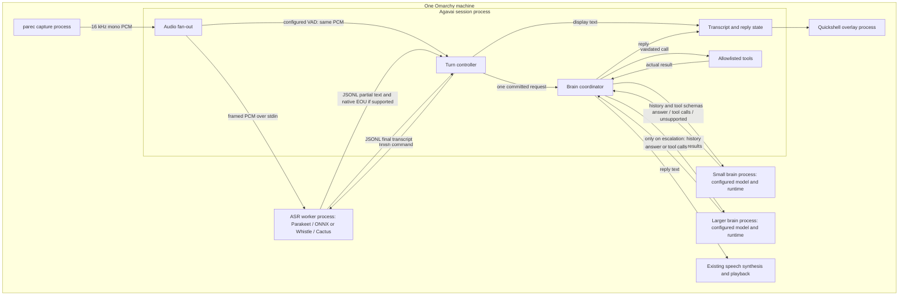

# Replaceable speech and brain engines on Omarchy

## Requirements

**Ask the small local model first. Ask the larger model only when the small one cannot handle the request.** Qwen is a local brain; it is not inherently the larger tier. Needle can handle supported tool requests directly, rather than routing every request into Qwen.

Scope is the existing Omarchy desktop. Keep microphone capture, overlay, tool permissions and speech playback. Support Parakeet/ONNX Runtime and Whistle/Cactus without teaching the session their model-specific APIs. Support brain backends independently of speech selection. The core adapters, configuration, worker lifecycle and conditional escalation are implemented; [engines.md](engines.md) documents exact current keys. Explicit energy VAD endpointing for Whistle is implemented; see [the debugging report](debug-whistle-needle.md) for the deployment correction and evidence.

Current [flow.md](flow.md) and [audio.md](audio.md) require partial words and native EOU or Enter to submit. This proposal preserves that for Parakeet. Batch recognition and optional VAD endpointing are explicit extensions documented in those specs. Other operating systems and remote deployment are outside this iteration.

## High-level design

Separate three decisions: **what model**, **which runtime executes it**, and **when the user has finished speaking**. Changing one must not silently change the others.

| Choice | Model | Runtime | How a turn ends |
|---|---|---|---|
| Existing speech backend | Parakeet Realtime EOU | ONNX Runtime | Native EOU or Enter |
| Candidate speech backend | Whistle | Cactus | Explicit energy VAD policy or Enter |
| Existing brain backend | Qwen GGUF | llama-server | Application accepts answer or tool result |
| Candidate small brain | Needle | Cactus | Application accepts supported tool result or escalates |

Whistle **supports streaming and whole-clip transcription**. Its Python API yields committed words plus a pending tail and flushes the tail when input ends. Committed words are not an end-of-turn signal. A future batch-only recognizer can implement the same input lifecycle and emit no partials.



The brain arrows are loopback HTTP for llama-server and framed requests/JSONL responses for a Cactus worker. Adapters hide that transport difference. Workers remain warm; model selection happens at session startup. Reconfiguration waits until idle or restarts the session, never swaps a runtime during a request.

**Why these boundaries:** keeping all inference in the session saves IPC but couples native dependencies and crashes to the UI/session. Separate workers cost process memory and startup time, but reuse the current Parakeet/llama deployment shape and isolate failures. Separate Whistle and Needle workers are a design choice, not a claim that Cactus cannot load both models. A universal `infer()` API would hide essential speech lifecycle differences; use two small, task-specific interfaces instead. No dynamic plugin discovery is needed: an explicit registry of supported adapters is sufficient.

## Modules

### Audio and turn controller — session process

One capture feeds recognition, the level meter and, if configured, a VAD classifier. Reuse the classifier in `vad_silero.py` where suitable; do not reuse a second microphone capture or silently fall back to energy detection. The controller owns `listening → finishing → committed` or `cancelled` state for one utterance at a time.

Endpoint policy is `native`, `manual`, or `vad` (explicit energy classifier for Whistle). Validate native EOU support before starting. Enter always requests finish; Escape cancels. Under VAD, speech-start detection and silence duration are explicit settings, evaluated for premature cuts and pauses. The selected energy policy reuses the existing 250 ms minimum speech and 900 ms trailing-quiet defaults, configurable in `[vad]`; long pauses can split a sentence and noise can delay the endpoint. A maximum duration is an error/explicit user decision, not an automatic command submission.

Throughput is one live microphone stream at 32 KB/s (16 kHz, mono, signed 16-bit). Configure maximum utterance duration and queue capacity; overflow fails the utterance visibly rather than dropping speech. Record speech-start/end markers, endpoint reason, queue delay and commit time. The existing eval goal of 0.5 s from speech end to commit is a target, not an achieved SLA.

### Speech adapter and worker — one selected subprocess

The session-facing contract is:

- `start(utterance_id)` opens a fresh utterance after worker readiness.
- `feed(utterance_id, pcm)` accepts ordered audio in the shared capture format.
- `finish(utterance_id)` stops input and requests final decoding, including pending tail.
- `cancel(utterance_id)` discards the utterance without submitting it.
- Events: `partial(full_display_text)`, optional `endpoint`, `final(full_text)`, `cancelled`, and `error`. Every event carries its utterance ID.

The worker handshake declares protocol version, backend identity, partial-text support and native-EOU support. Normalize Whistle's committed-plus-pending output into replacement display text. Its adapter converts PCM to float samples and owns chunk accumulation. Parakeet retains its 160 ms inference steps and streaming cache. A batch adapter alone owns the full-utterance buffer and decodes on finish; the session does not duplicate it.

Use typed length-prefixed input frames for start/audio/finish/cancel, and JSONL output. Replace the current ambiguous zero-length flush/reset convention. Serialize commands after accepted audio. On native EOU the Parakeet adapter stops extending its hypothesis; later queued audio must not leak into the final transcript. A simultaneous Enter is idempotent. Final text can commit only after a finish decision; stable chunks never commit. Ignore stale IDs and require cancellation/reset acknowledgement before the next utterance.

Configure worker executable/environment, model artifact, supported device, chunk size, startup deadline and absolute finish deadline. A timeout or crash cancels that utterance and reports an error; restart for a fresh request, never execute a partial. Bound deadlines from operation start, not time since the last event. Process one utterance at a time; sustain faster-than-real-time decoding without unbounded queues. Log load time, first partial, per-chunk compute and final-tail time separately. Whistle timings on this Omarchy machine remain unmeasured.

### Brain coordinator and adapters — session plus inference processes

Reuse the existing tool loop and llama HTTP parsing behind a `respond(history, tools)` adapter. Normalize results to `answer`, `tool_calls`, `clarify`, `unsupported` or `error`. These are application outcomes; do not assume every model natively emits them or supplies calibrated confidence.

The coordinator first tries the configured small model. For Needle, no matching calls means unsupported, not success or “Done.” Valid calls pass existing schema, allowlist and confirmation checks. A successful simple tool action can use an existing/deterministic result acknowledgement without asking Qwen to rephrase it. Unsupported requests or explicit inability escalate once. Invalid model output may escalate with a recorded reason; infrastructure failures remain visible even if configured escalation recovers. Clarification asks the user when required arguments are missing. A fluent answer alone does not prove correctness: acceptance of general answers needs task-specific evaluations before enabling that path.

Keep shared history and completed tool results in the session. Escalation includes them and the reason for escalation. Never replay an executed action merely because the model changed; an ambiguous tool failure stops for resolution. Remove unconditional Qwen health/context-classification calls before the small attempt. Preserve finalized local controls before any model call. Conversation continuation must be handled inside the selected small path or escalated with history, not through a hidden mandatory larger-model call.

The selected runtime owns model loading, readiness and shutdown. One request/tool loop runs at a time. Configuration separates small/large roles from model files and engine options; reuse existing max-tool-round and response-timeout limits. Log model/engine/version, attempt duration, escalation reason, tool calls and final outcome. Keep both tiers warm where memory permits; otherwise report larger-tier load time in the escalated latency. Larger-tier failure yields an explicit failure, not another unbounded fallback.

### Profiles and evaluation — configuration and existing eval runner

Profiles select supported combinations, not arbitrary interchangeable model files. Proposed keys, not current config:

```toml
[asr]
backend = "whistle-cactus"
model_path = "/models/whistle.cact"
device = "cpu"
endpoint = "manual"

[brain.small]
backend = "needle-cactus"
model_path = "/models/needle.cact"

[brain.large]
backend = "llama-server"
model_path = "/models/qwen.gguf"
```

This is one experiment, not a decision that Qwen must be the larger tier. Small Qwen followed by a larger configured model also fits. To select Parakeet, change the speech backend to `parakeet-onnx`, its artifact directory and endpoint to `native`; the brain configuration stays the same. Runtime-specific executable/provider/thread settings belong to their backend, not a GGUF-only common `ModelSpec`.

On startup validate installed runtime build, Linux architecture/CPU features, model format, device/provider availability and endpoint capability. Missing support is an actionable startup error. No silent CPU/engine substitution in comparisons. Keep runtime dependencies separate from the TTS environment and pin artifacts at installation; do not download inside the audio loop. Other OS installers/capture layers are deferred.

Use the same adapters in live operation and audio replay; `evals/voice_helper.py` must stop importing Parakeet directly. Evaluate one profile at a time with identical audio and tool fixtures. Fingerprint model hash, runtime build, hardware/device, chunk/endpoint settings and warm/cold state. Measure transcript quality, premature/missed turns, tool success, escalation rate and latency; speed without task success is insufficient. Startup preflight and per-request timing are reported separately.

## Low-level design

### “Open the browser” — small model succeeds

```mermaid
sequenceDiagram
  participant C as Capture
  participant E as Turn controller
  participant R as ASR worker
  participant B as Brain coordinator
  participant S as Small brain
  participant T as Allowlisted tools
  C->>R: PCM via session
  R-->>E: Partial words (display only)
  Note over E,R: Native EOU, Enter, or configured VAD ends input
  E->>R: finish(utterance_id)
  R-->>E: final("open the browser")
  E->>B: Commit once
  B->>S: Request + history + allowed tool schemas
  S-->>B: launch(browser)
  B->>T: Validated, confirmed if required
  T-->>B: Browser opened
  Note over B: Reply from successful result; no larger-model call
```

### Small model cannot handle the request

The same finalized transcript enters the small model. An unsupported result causes the coordinator to send the request, relevant history and any completed tool results to the larger model. Its answer/tool calls return through the same validation and reply path. Whistle batch mode changes only the speech portion: no partials, then full decode after finish. The UI shows listening/transcribing instead of fabricated words.

### Latency expectations

| Interval | Expected behavior / evidence |
|---|---|
| First partial | Parakeet works in 160 ms steps. Whistle API suggests roughly 1 s chunks; that buffering can dominate despite faster compute. Batch has no partial latency. |
| Speech end → commit | Endpoint wait + queued audio + final-tail decode + IPC. Existing eval target: 0.5 s. VAD silence is part of this budget. |
| Commit → small success | Small inference + validated tool execution if needed + reply preparation. No larger inference on this path. Not yet measured for Needle. |
| Commit → escalated success | Small attempt + any larger cold load + larger inference/tool loop. Escalation has a real added cost. |
| Reply text → audio | Existing TTS/playback path; measure separately from model time. |

Whistle is expected to reduce inference cost; it is not yet a measured latency promise on Omarchy. Vendor comparisons use Apple M4 Pro hardware and cannot establish our CPU results. Historical Ryzen 3900X/Qwen3-4B report `20261010-1250` measured median first words 0.674 s, speech-end-to-commit 5.895 s (4 of 12 missing within an 8 s tail), and commit-to-simulated-desktop-change 4.870 s. These are historical product probes, not Whistle predictions. Report p50/p95 and failures from a new same-hardware comparison before choosing defaults.

## Conclusion & References

The speech lifecycle, Parakeet/Whistle adapters, brain registry and conditional escalation are implemented. The native fixture checks cover both Cactus models and the Parakeet worker. Use [engines.md](engines.md) for setup and exact settings. Whistle energy endpointing has recorded-audio regression coverage; live-microphone tuning and comparative quality/latency benchmarking remain follow-up work.

- Current contracts: [flow](flow.md), [audio](audio.md), [model direction](v2.md#model-escalation-direction--2026-10-23), [installation](install-bundle.md).
- Existing code: [ASR](../src/agavai/asr.py), [LLM](../src/agavai/llm.py), [orchestrator](../src/agavai/orchestrator.py), [config](../src/agavai/config.py), [voice eval](../evals/voice_helper.py).
- [Whistle model card](https://huggingface.co/Cactus-Compute/whistle), [Needle source](https://github.com/cactus-compute/needle), [cactus-needle 3.2.8](https://pypi.org/project/cactus-needle/3.2.8/): inspected `needle/agent/whistle.py` streaming and finish behavior on 2026-10-23.
- [Historical report](../evals/results/20261010-1250/report.json). Design patterns: task-specific adapters, explicit lifecycle state, conditional escalation, process isolation.
