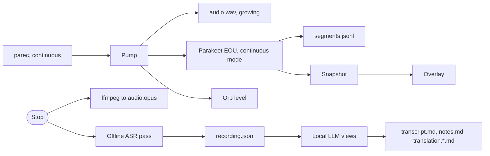

# Recordings

Status: design agreed 2026-10-23. P0 is deployed locally from `feature/recordings` on 2026-10-25; what P0 includes is under [P0 as built](#p0-as-built). Decisions are listed at the end, and progress is tracked in [tasks/recording.md](../tasks/recording.md).

The Requirements, Using it, Views and design sections describe the product direction,
including deferred features. The as-built section distinguishes deployed P0 from the
current branch's harness follow-ups, which have not been deployed. It is the reference
for which views, controls and source requests are implemented.

Agavai can listen without answering. It keeps the audio, a timestamped transcript, and your corrections, so you can play any moment back later. The same recording can become a transcript, notes, or a translation. The assistant loop stays as specified in [flow.md](flow.md), and the overlay rules stay in [ui-design.md](ui-design.md). This file covers only what recording adds or changes.

## Requirements

- **One idea: record first, decide later.** A recording is always the same thing: audio plus a timestamped transcript. Transcript, Notes, and Translation are views of it. You never choose a mode in a dialog before you start. What you say to start it picks the first view, and you can switch views at any time, during or after recording, without recording again.
- **Starting takes one gesture.**
  - Voice in an ordinary Agavai session: "record this", "take notes", "transcribe this meeting".
  - Super+Ctrl+M, which toggles recording.
  - `agavai record` on the command line.
- **While recording, speech is content.** Agavai does not answer, route, or speak. Nothing you say goes to OpenRouter. The only voice controls are separate, isolated utterances that start with the name: "Agavai stop", "Agavai pause", "Agavai resume", "Agavai mark".
- **Recording is always visible.**
  - The orb shows a red recording ring and the elapsed time, even when minimized.
  - The bar shows a recording indicator, like Omarchy's screen recording indicator.
  - Start and stop each play a distinct short chime.
- **Stopping never loses work.** The audio and the live transcript are saved the moment you stop. × also stops and saves. Discarding is a separate action after stop, and it asks for confirmation.
- **Review is listening with the text.**
  - Each transcript line carries its time. Clicking a line plays the audio from there.
  - During playback, the current line is highlighted.
  - You can correct a line in place, and the original stays available.
- **Recordings are plain files** in a folder you can see, back up, and open in any editor.
- **Recordings outlive the session.** The assistant can use any of them later:
  - "Make notes from the last recording"
  - "Translate yesterday's standup into Spanish"
  - "What did I say about invoices?"
  - "Play from where I mentioned the deadline"

## Using it

### Start

| Gesture | Result |
|---|---|
| "Agavai, take notes" (any wording that asks to record, take notes, or transcribe) | Recording starts in the current session. The first view comes from the wording: notes or transcript. |
| Super+Ctrl+M | Starts a recording in the Transcript view. Pressing it again stops. This mirrors Alt+Print for screen recording. Super+M stays the assistant. |
| `agavai record` | Same as Super+Ctrl+M, from scripts. `agavai record stop\|pause\|resume\|mark` control a running recording. |
| Super+M while recording | Raises the recording sheet. It does not start a second capture. |

### While recording

The overlay keeps its corner and orb (see [ui-design.md](ui-design.md)).

- **Compact.**
  - The orb draws a steady red ring instead of the breathing listening ring, and still moves with your voice.
  - A small timer chip sits beside it, such as `● 12:04`.
  - This is the one exception to "compact hides all text": recording must never be invisible.
- **Expanded.** The sheet shows the live transcript:
  - Committed lines show their `mm:ss` time.
  - The current partial line is dimmed, next to the orb.
  - The view stops scrolling on its own while you are reading earlier lines.
  - The view chip (`Transcript ▾`) at the top switches views live.
- **Controls next to the orb.**
  - **Pause / Resume.** Paused time is not recorded and is shown as a gap. The recognizer still hears during a pause, so "Agavai resume" works, but nothing heard then is kept or shown.
  - **Mark.** Drops a bookmark at the current moment, with an optional typed label.
  - **Stop.** Ends and saves.
- **Voice controls.** Only an isolated committed utterance of "Agavai stop", "Agavai pause", "Agavai resume", or "Agavai mark" acts. It uses the same whole-utterance rule as the existing controls (see [flow.md](flow.md)). The control's words are dropped from the transcript and its moment is marked in the audio. Anything longer, such as "Agavai stop the server before deploying", is content.
- **Bar indicator.** It shows the elapsed time. Clicking it stops and saves, like Omarchy's screen recording indicator. Minimizing or losing focus never affects recording.

### After stop

1. **Saved.** The recording folder exists at once, with the audio and the live transcript.
2. **Polishing.** A background job transcribes the full audio again with a more accurate offline model. The result has punctuation, capitals, better word choice, and language detection. The job then writes a title and the selected view. The sheet shows progress ("Polishing transcript… 40%") and stays usable. The live transcript is replaced when the polished one is ready, and your corrections are kept.
3. **Review sheet.** It opens in the same corner:
   - **Header.** An editable title, the date, the duration, and the view tabs: Transcript, Notes, Translation, with the language as a menu.
   - **Player row.** Play/Pause, back 10 s, forward 10 s, a scrubber with mark flags, the time, and speed (1×, 1.5×, 2×).
   - **Transcript.** Click a line to play from it. The current line is highlighted during playback. Double-click a line, or press ✎, to correct it; Enter saves.
   - **Corrected lines.** They carry a small dot. "Show original" reveals the raw recognizer text.
   - **Replace across the recording.** "Replace…" changes a word everywhere, for example "cube flow" → "Kubeflow".
   - **Stale views.** After a correction, a view generated from the old text says so and offers **Update**.
   - **Actions.** Copy, Open folder, Export (Markdown, plain text, SRT subtitles), and Delete, which asks for confirmation.
4. **The assistant keeps listening.** The recording becomes the conversation context. "Make notes", "Translate it to German", and "What were the action items?" all apply to this recording, without naming it.

### Later

- "Show my recordings", or the Recordings action on the idle sheet, lists recordings by newest first. Each row has the title, date, duration, and the views already made. It uses the existing list canvas.
- Selecting a row opens its review sheet.
- "Find the recording where I talked about the budget" searches every transcript and lists the matching lines. Selecting a line opens the recording at that line.

## Views

| View | What you get | Made by |
|---|---|---|
| Transcript (always) | Every line with its time, punctuated, your corrections applied | Live recognizer, then the offline pass |
| Notes | A summary paragraph, then headings, bullets, decisions, and action items, each linked to the time it was said | Local LLM over the transcript |
| Translation (to a language), later phase | Each line translated, shown under the original or alone | Local LLM, line by line, so lines stay seekable |

New views are new prompts over the same transcript. They never need a new recording.

## Storage

The default folder is `~/Documents/Agavai/Recordings/`. Change it with `[recordings] dir`. Each recording is one folder, named by its start time and title:

```
2026-10-23 17.45 Team standup/
  audio.opus           speech, mono, about 11 MB per hour
  recording.json       metadata, segments, marks, and corrections (source of truth)
  transcript.md        readable transcript with times (regenerated)
  notes.md             if made
  translation.de.md    one per language, if made
```

`recording.json` holds:

- Title, start time, duration, status (`recording`, `processing`, `ready`), and the models used.
- For each segment, its start and end in milliseconds and three text layers: `live`, `final`, and `corrected`. Display uses `corrected`, then `final`, then `live`.
- Marks.

The Markdown files are exports for reading and sharing. They are regenerated from `recording.json`, so editing them does not change the recording. Corrections are made in the review sheet.

## High-level design



- **Capture.** ListenSession already owns the microphone, so recording runs in that same process. Unlike the assistant path, capture does not stop at an end of utterance, because a gap there would lose audio. One `parec` stream feeds three consumers: a WAV file, the live recognizer, and the orb meter.
- **Audio file.** Recording writes plain 16 kHz PCM WAV (about 115 MB per hour) and flushes every second. A crash or power loss still leaves a playable file; recovery fixes the header. On stop, ffmpeg encodes `audio.opus` and the WAV is deleted after the Opus file is verified.
- **Live recognizer.** Parakeet EOU gains a continuous mode. After an end of utterance it resets its decoder without dropping queued audio. It reports each segment's start and end from the sample count, accurate to one 160 ms step. Each committed segment is appended to `segments.jsonl` and published to the snapshot. The shared `asr_worker.py` transport runs Parakeet in continuous mode for recording. If the assistant uses Whistle, recording uses the separately installed Parakeet model and runtime at their default paths; the assistant configuration stays unchanged. The assistant path keeps its configured recognizer and per-utterance behavior.
- **Offline pass.** This runs after stop, as `agavai recordings process <id>` at low CPU priority. It is a detached job, so it survives dismissing the overlay.
  - **Model.** The proposed model is [Parakeet-TDT-0.6B-v3](https://huggingface.co/nvidia/parakeet-tdt-0.6b-v3): 25 European languages, punctuation, capitals, and word timestamps. It needs its own pinned download script. Voxtype's copy is not read, to keep the two apps separate as [flow.md](flow.md) requires.
  - **Alignment.** Word timestamps re-align the segments, so corrections and marks keep their place.
- **Views.** These use the existing `agavai-llm` model on port 18766. Its context is 8,192 tokens and an hour of speech is about 12,000. Notes therefore summarize the transcript in chunks and then combine the chunk summaries. Translation sends batches of lines.
- **Overlay.**
  - **Snapshot.** It gains a `recording` block: status, elapsed time, paused, view, the last committed lines, the partial line, and marks.
  - **Canvas.** It gains a `recording` kind for review: the audio path, segments, and view HTML.
  - **Playback.** It reuses the QtMultimedia player that `ResultBrowser.qml` already uses for video.
  - **Bar.** `BarWidget.qml` shows the recording indicator.
- **Assistant tools.** A new `recordings` head offers `start_recording(view, language)`, `list_recordings`, `search_recordings`, `open_recording`, and `make_view(recording, view, language)`. Starting by voice is an ordinary assistant turn. Once recording starts, utterances bypass the router and the model entirely.

## Decisions

**Record first, views later.** The alternative is a mode picker (Notes, Transcribe, or Translate) shown at start. A picker makes every start a decision. Picking wrong would mean recording again, and some purposes only become clear afterwards: a lecture you are transcribing turns out to need notes. Asking for one view in the start sentence keeps the shortcut path at zero decisions.

**Speech is content while recording.** The alternative is to keep answering name-addressed requests during a recording. Then any sentence in a lecture or meeting could trigger an action or send audio content to OpenRouter. Only isolated "Agavai stop", "pause", "resume", and "mark" act, and all other speech stays on the machine.

**Native in Agavai, not Voxtype's meeting mode.** `voxtype meeting` already does continuous transcription, speaker labels, and export. It is a separate daemon with its own interface. Driving it from Agavai would couple to the Voxtype service, which [flow.md](flow.md) rules out. It also would not give one overlay that holds the audio player, the transcript, and corrections together.

**Two recognizer passes.** The live model gives immediate words and timing. The offline model gives the transcript you keep: punctuation, better accuracy, and other languages. A single offline pass would leave the sheet empty while you record. A single live pass would keep the live model's lowercase, unpunctuated, English-only text.

**WAV while recording, Opus when done.** Encoding Opus live saves disk space during recording. It would also tie the audio to a second process that can fail mid-recording, and a crash would leave a damaged stream. Raw WAV costs about 115 MB per hour while recording. It needs no encoder and stays recoverable.

**Corrections are a layer, never an overwrite.** The offline pass can re-run, a model can be upgraded, and "Show original" stays honest. Corrected text has a stable segment identity, so views can tell when they are stale.

**One JSON source, Markdown as export.** Letting edits in the Markdown files flow back would need parsing free text back into timed segments. The review sheet is where corrections happen. The Markdown files are always readable and safe to share.

## How it fails

| Failure | What happens |
|---|---|
| No microphone | An error shows before recording starts. No folder is created. |
| Live recognizer stops mid-recording | Audio keeps recording. The sheet says "Live transcript stopped; the full transcript is made after you stop." The offline pass transcribes everything. |
| Disk full | Recording stops and keeps what was captured, and an error names the folder. |
| ffmpeg missing or fails on stop | The WAV is kept and the review sheet plays it. A Retry encodes it again. |
| Offline pass fails | The live transcript stays, with "Couldn't polish the transcript" and Retry. |
| Local LLM is down | Transcript and playback still work. Views show the existing systemctl hint. |
| Overlay dismissed or the shell restarts | Recording continues, because the process owns it. The bar indicator stays. Invoking Agavai raises the recording sheet. × on the sheet stops and saves. |
| Crash or power loss | On next start, a recording still marked `recording` with no live process is finalized from its WAV and `segments.jsonl`, and is listed as recovered. |
| F9 dictation during a recording | Both capture the same microphone, so the dictated words are also recorded. Agavai does not block it, as with the assistant today. |
| "Agavai stop" lost inside a longer utterance | It is content, by the whole-utterance rule. The shortcut, the bar indicator, or the Stop button still stop. |

## Phases

| Phase | Scope |
|---|---|
| P0 Record and review | Start by voice, shortcut, or CLI. Continuous capture to WAV, then Opus. Live transcript with times. Recording folder. Review sheet with player, clickable lines, and corrections. Library list. Bar indicator and chimes. Crash recovery. |
| P1 Views | Offline polish pass, title, Notes, voice follow-ups on the open recording, search, export. |
| P2 Later | Computer audio as a second channel. Labels for You (microphone) and Others (computer) come free from separate channels. Translation, first as text through the local LLM and then live while recording. A glossary learned from corrections. |

## P0 as built

- **Start.** Super+Ctrl+M (`agavai record`), the CLI, and voice all start a recording. A voice start enters recording through the controller; the chime and visible state acknowledge it.
- **Ending.** A recording started from the shortcut ends its session when it stops, closing the microphone and leaving the review on screen. One started inside an assistant session returns to listening.
- **Review.** It has playback, click-to-seek lines, the highlighted current line, mark ticks, speed, corrections with "Show heard words", and "Open folder". Copy, Export, Delete, Replace across the recording, and the view tabs are not built yet; a recording is deleted by removing its folder.
- **Live transcript.** P0 keeps the live recognizer's text: lowercase, unpunctuated, English. The title is "Recording" until P1 adds the polish pass and titles.
- **MCP.** `start_recording` and `list_recordings` are not offered over `agavai mcp`.

## Harness follow-ups on the rewrite branch

Saved recordings bind to session context at capture completion. “Summarize this
recording”, “make notes from the last recording” and explicit transcript questions
load corrected segments directly, without screen OCR. If no active or unique source
exists, the harness asks which recording; “last recording” selects the newest.
A language-capable local brain is required.

Interpretation publishes a canvas and short spoken lead. Revisions are checked before
publication; concurrent edits reject stale answers. Long input uses bounded chunks
and a combining request. Larger sources fail explicitly. This does not implement
planned Notes/Translation tabs, timestamp links, search/export or durable derived
views. Translation quality depends on the configured model; P2 language polish is
still deferred.

Voice edits support “replace old with new” for one unique occurrence, optionally in
a line, or “correct line N to full corrected text”. Ambiguity changes nothing.
Correction overlays preserve heard words and mark earlier derived output stale.
All correction writers share a per-recording advisory edit lock; source-derived
edits reject an effective line that changed after resolution.

Record/cancel shortcuts invalidate waiting inference without waiting for its timeout.
Voice start may therefore begin before a model reply is spoken; the chime and visible
recording state acknowledge it. Recording controls remain isolated, name-addressed
utterances; meeting content never becomes desktop intent. This branch implementation
does not imply deployment.

## Decisions taken

Decided with the user on 2026-10-23:

1. **Microphone only to start.** Computer audio comes in a later phase.
2. **Translation comes later.** It moved to P2, so the offline model choice for other languages waits until then.
3. **Folder and retention.** `~/Documents/Agavai/Recordings/`, kept until the user deletes a recording.
4. **Record shortcut.** Super+Ctrl+M, today a duplicate of Super+M, becomes the record toggle. Super+M stays the assistant.
