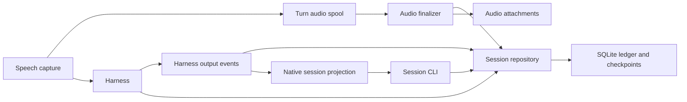
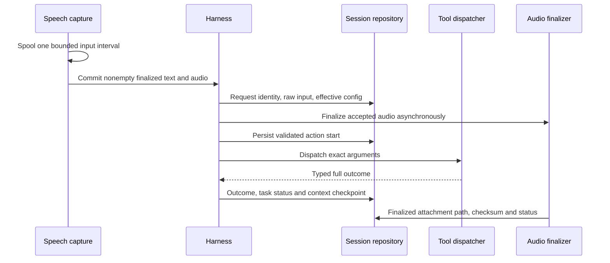

# Durable Agavai sessions

## Requirements

Persist the harness facts needed to inspect a voice interaction: committed input,
task changes, routing/model decisions, exact action arguments and full outcomes,
answers, source revisions and complete context. Retain accepted spoken-turn audio
by default, as selected by the user. Typed turns have no audio; abandoned captures
and microphone idle time are not durable recordings. Explicit recordings keep
their existing repository and are referenced rather than copied.

Provide headless inspection/export and safe resume, plus native session identity
and history selection. Resume never submits an old request, restores confirmation
authority, or claims an interrupted side effect failed. Personal preferences and
semantic memory remain outside P2. [flow.md](flow.md) governs commitment and actions;
[voice-agent-harness.md](voice-agent-harness.md) governs the event boundary.

## High-level design



| Approach | Benefit | Cost | Choice |
|---|---|---|---|
| Persist ui.json | Small change | Loses full outcomes, history and execution authority boundaries | Keep as disposable projection |
| JSONL only | Readable append log | Cross-record consistency, querying and checkpoints need another protocol | Export JSON, use transactions internally |
| SQLite plus audio files | Transactional facts, inspectable standard format, bounded database size | File publication needs explicit recovery | Chosen, standard library SQLite |
| External memory service | Independent operations | Adds deployment and network dependencies for one local user | Outside this scope |

Default root is `$XDG_DATA_HOME/agavai`, overridable by `[sessions] dir` or
`AGAVAI_SESSION_DIR`. `sessions.sqlite3` has schema version 1. Session-local event
sequence is the durable ordering key; timestamps are for display. SQLite WAL,
foreign keys and full synchronous commits protect the action-start record before
dispatch. A per-session OS file lock rejects concurrent resume/mutation; separate
sessions may write concurrently. Unsupported newer schemas fail explicitly.

Raw microphone levels, provisional partials and repeated live recording frames
are transient; the durable timeline contains committed domain/lifecycle events.
Session start stores effective model/ASR/VAD/router settings and a config digest,
without environment secret values. Checkpoints contain explicit context fields,
never sockets, worker handles, callbacks or executable pending confirmations.

New `task_status` events retain the finalized serialized `TurnResult` alongside
`status`. It matches the direct return value, including request-local outcomes
and inclusive event bounds; no SQLite schema change is required. Earlier events
without this additive payload still replay. Blank rejected input has no durable
turn. Audio finalization can publish later events outside the result's range.
The [result contract](voice-agent-harness.md#structured-turn-result) defines the
typed interface; restoring a result never restores execution authority.

An action-start event is committed before dispatch. If the process dies before
the result is committed, inspection/resume treats that outcome as unknown. On
resume, incomplete exchanges are reconstructed with actual/unknown tool results;
the old request is never run. Old Yes/Continue cannot authorize replay after
recovery. Missing sources and attachments are reported as missing.

Audio is spooled with a bounded memory threshold on the existing capture thread.
Only a committed nonempty spoken turn publishes it. Leading/trailing quiet frames
are trimmed using the existing configured energy threshold; this is storage
trimming, not a new endpointer. A single finalizer (at most two pending attachments) encodes accepted audio using
the existing recording encoder; WAV is retained with a warning if Opus is
unavailable. Publication is atomic and checksummed. Interrupted attachments stay
incomplete; they are never silently labelled ready. No PCM is placed in events.

Persistence and audio default on. `save_audio=false` keeps transcripts/events.
`enabled=false` keeps the existing memory-only harness. Retention defaults to no
expiry; `retention_days=0` and `max_audio_mb=0` mean unlimited. A configured audio
quota uses conservative PCM reservations and refuses additional attachments with
an observable status rather than deleting existing audio. Incomplete/failed
reservations also count until explicit session deletion; retained artifacts cannot
silently bypass the limit. Explicit prune/delete commands require confirmation;
session deletion never deletes a referenced explicit recording. Exports include
ledger JSON, available attachments and source references, never source copies.

## Modules

### Session repository

- **Deployment:** standard-library SQLite and filesystem I/O in the caller.
- **Lifecycle/protocol:** create/list/inspect/claim/checkpoint/resume/close,
  transactional event/turn/execution/source records, export/delete/prune.
- **Performance:** small synchronous transactions before side effects; no measured
  latency SLA. Large audio stays outside SQLite.
- **Throughput:** one writer per session, SQLite serialization across sessions.
- **Configuration:** `[sessions]` location, enablement, audio quota and retention.
- **Observability:** full ordered facts, config fingerprint, attachment states,
  explicit I/O/schema/lease failures. Storage failures stop further dispatch.

### Harness integration

- **Deployment:** in-process `Harness`, using the existing event producer.
- **Lifecycle/protocol:** record canonical events before the presentation sink;
  checkpoint on turn completion and session close; resume without stale authority.
- **Performance:** transient levels/partials avoid database writes; callback and
  checkpoint work stay bounded by the existing session history.
- **Throughput:** existing single turn/controller contract.
- **Configuration:** session ID is explicit on resume, persistence opt-out in config.
- **Observability:** session metadata/lifecycle and recovery notices use events.

### Audio capture and finalization

- **Deployment:** existing capture pump plus one local finalizer per harness.
- **Lifecycle/protocol:** temporary capture → accepted request attachment → atomic
  finalized file and metadata; cancellation/empty input discards temporary capture.
- **Performance:** capture writes run off the controller; encoding has a bounded
  subprocess deadline. No model call waits for a new audio encoder to finish.
- **Throughput:** one bounded ordinary-turn capture and one finalizer; explicit
  recordings reuse their existing capture/storage path.
- **Configuration:** audio retention, ASR maximum duration, energy trim threshold.
- **Observability:** relative path, codec/rate, duration, timestamps, checksum,
  writing/ready/incomplete/missing/failed/quota_exceeded status and encoding warnings.

### CLI and native projection

- **Deployment:** existing CLI and Quickshell surface, no additional service.
- **Lifecycle/protocol:** list/show/new/resume/close/export/delete/prune;
  `ask --session` and `listen --session` use the same harness repository.
- **Performance:** history list is bounded; inspection/export are explicit user work.
- **Throughput:** one active microphone owner; switching waits for clean dismissal.
- **Configuration:** same storage root and snapshot protocol as the harness.
- **Observability:** visible session identity/history and inspectable JSON timeline.

## Low-level design



For restart/resume, claim the session lock, load its checkpoint and ledger,
mark unfinished actions unknown and incomplete audio explicitly, clear pending
confirmation authority, and publish the resumed session state. A new user turn
may then run using complete retained exchanges; loading itself performs no action.
Export reads canonical records and existing finalized attachments. Deletion claims
the session, removes its own attachments and ledger rows, and leaves recordings
referenced by that session untouched.

The CLI uses the same loaded configuration:

```bash
agavai session list                         # JSON summaries, newest first
agavai session show SESSION_ID              # ordered facts and current availability
agavai session new                          # create a closed blank session; print ID
agavai session new --listen                 # open a fresh native voice session
agavai session resume SESSION_ID            # select a saved native voice session
agavai ask --session SESSION_ID "continue"  # typed continuation
agavai listen --session SESSION_ID          # foreground voice continuation
agavai session close SESSION_ID
agavai session export SESSION_ID ./export  # destination must not already exist
agavai session delete SESSION_ID --yes
agavai session prune --older-than-days 30 --yes
```

`retention_days` supplies the default for explicit `prune`; no scheduler is installed.
List/show/export also work headlessly. Resume/new --listen require the native shell.
Native selection and typed continuation dismiss the current microphone owner and
wait up to five seconds for clean closure. A slow action/encoder produces a visible
retryable error; it is never force-killed. Direct headless resume rejects a held
lease. With persistence disabled, the native indicator says temporary and history
is disabled. SQLite contains full text and tool results regardless of journal log
level; audio opt-out does not disable text persistence.

BDD coverage in [session_persistence.feature](../features/session_persistence.feature)
uses separate processes, real SQLite/files, scripted HTTP and OS/capture boundaries.
It covers restart/compaction, unknown effects, stale confirmations, competing
leases, storage failure, audio publication/crash/quota/opt-out, missing references,
export/deletion/pruning and native session selection. It does not establish a
power-loss guarantee for the whole storage device or model quality.

## Conclusion & References

The durable ledger makes routing and execution inspectable independently of the
UI and model context window. Audio attachments provide evidence for transcription
without turning idle microphone capture into a continuous recording.

- [P2 task and user audio choice](../tasks/session-persistence.md)
- [Harness event contract](voice-agent-harness.md#ui-independent-event-interface)
- [Runtime behavior](flow.md), [recording contracts](recording.md),
  [native UI](ui-design.md), [configuration](../share/config.example.toml)
- Existing implementations reused: [context](../src/agavai/harness/context.py),
  [execution](../src/agavai/harness/execution.py),
  [speech capture](../src/agavai/asr.py), [encoder](../src/agavai/recording.py).
- Patterns: transactional ledger/checkpoints, ports/adapters, OS process leases,
  atomic attachment publication, unknown-outcome recovery. No external memory
  framework was evaluated or added.
