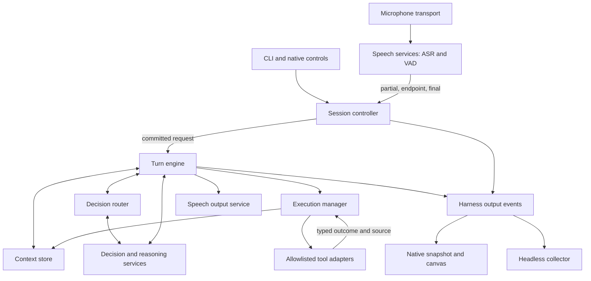

# Agavai as a voice-native agent harness

## Requirements

Agavai is the in-process harness. ASR, VAD, decision models, reasoning models and
speech synthesis are replaceable services behind explicit adapters. This is an
architectural rewrite of the existing application, not a separate framework or
another daemon. The native UI is a projection of harness state.

This document describes the implemented rewrite on the current branch;
[flow.md](flow.md) governs runtime behavior. This branch has not been deployed to
the host. No host configuration or model deployment changes are part of this rewrite. Existing
recording, confirmation and allowlist guarantees are retained by the implementation.

The initial harness must own:

1. **Voice commitment.** Revisable ASR hypotheses, explicit endpoint policies,
   pause/resume and cancellation. A partial or a silence event is never an action.
2. **Context.** Session identity, task boundaries, relevant history, active
   resources, transcript revisions, pending actions and bounded model inputs.
3. **Decisions.** Continue or start a task, resolve an explicit correction,
   select an action or reasoning path, request missing context, and narrow tools.
4. **Execution.** Validate calls, bind confirmations to their exact arguments,
   track completed calls, preserve actual outcomes across model escalation, and
   separate tool completion from fulfillment of the user's request.
5. **Output boundary.** Publish ordered, serializable decisions, sources and
   outcomes through a UI-independent event sink, then produce an appropriate
   spoken response. The native snapshot is one consumer.
6. **Architectural parity.** CLI, live voice, recordings, typed requests, evals,
   BDD fixtures and current specifications use the same harness contracts.

One local user and one active microphone session remain the supported workload.
Persistent personal memory, inferred preferences, remote agents and a general
plugin platform are outside this first implementation. Recording files remain
durable; conversation context remains session-scoped unless explicitly stated.

### Evidence motivating the change

On 2026-10-25, a saved-recording summary request selected `screen_context` through
Needle. The tool-only branch replaced its structured result with “The tools
returned results. See the details on screen.” and ended without Qwen. The saved
recording existed, but its transcript had not been attached to model context.
The same test session showed recording shortcut requests waiting behind an
approximately 55-second CPU Qwen call. These are separate failures in task
selection, source binding, completion policy and scheduling.

The [native comparison](../evals/results/20261025-brain-comparison-cached/README.md)
also found accepted wrong calls for self-corrections and general questions.
Schema validity and a no-match fallback cannot establish semantic correctness.
No component in this design may treat a model's claimed confidence as proof.

## High-level design

### Ownership and component boundaries

The decision layer is central, but it proposes a route; the harness owns state
transitions and execution authority. Acoustic timing, exact local controls,
permission checks and cancellation do not depend on a model agreeing with them.



All controller, context, decision and execution components above run in the
Agavai Python process. Model services can remain local HTTP servers or existing
isolated workers. “Service” describes their contract, not a requirement to run
each component as a network daemon. Quickshell remains a separate presentation
process; it never stores the authoritative model history or pending action.

### Decisions and alternatives

| Approach | Benefit | Cost / failure | Decision |
|---|---|---|---|
| Extend the existing head router only | Small diff; retains fast tool selection | Cannot represent correction, source selection, topic change or fulfillment | Keep as a tool-schema selector inside the harness |
| Give one model every control and tool | Few application rules | Wrong accepted calls, expensive history, model-dependent cancellation | Do not use as the control plane |
| Make a remote harness daemon or separate framework | Independent deployment | Adds state ownership and IPC to a single-user application | Agavai remains the in-process harness, per user direction |
| Deterministic controller with a semantic decision layer | Explicit lifecycle; replaceable models; testable decisions | More explicit contracts and task-state handling | Chosen |

The decision layer chooses task relation, source binding and capability.
The implemented routing module recognizes supported English source/correction/question
forms; the language tier classifies task relation and resolves self-corrections.
This is explicit policy with model decisions, not a claim that keyword rules
understand arbitrary intent. Ambiguous edits and invalid decisions stop for
clarification. The existing router module still only selects tool heads. An action model
then proposes concrete calls within that route. The execution manager validates
them. A general language model interprets results when the task needs an answer,
summary or explanation. A simple verified action can finish with a deterministic
acknowledgement; it need not invoke another model just to say “opened.”

Needle's supported role is tool-call proposal. A provider that cannot produce
semantic decisions must not be labelled a general context router merely because
it emits a valid function name. The configured chat-capable model handles
decisions that require language reasoning; its latency is visible. The harness
does not silently add a cloud dependency or promise that current CPU Qwen can
meet interactive routing targets.

### Three different contexts

| Context | Contains | Owner / lifetime |
|---|---|---|
| Session | Session ID, capture mode, current task, cancellation | Session controller; one listener |
| Task | Committed requests, relevant results, active recording, corrections | Context store; retained within the session |
| Execution | Current request, model attempt, advertised schemas, pending confirmation, completed calls and outcomes | Execution manager; one turn, with explicit pending-action continuation |

A new task archives the previous task and drops inherited tools and unrelated
conversation from the next prompt. It does not delete recordings or pretend earlier actions never ran.
Continuing a task keeps its relevant sources. A correction changes a source or
pending request revision; it never rewrites the historical result of an action.

### UI-independent event interface

The public interface has no concrete UI parameter:

```python
events = []
harness = Harness(cfg, on_event=events.append, should_cancel=cancelled.is_set)
reply = harness.run_turn("list the planets")
serialized = [event.to_dict() for event in events]
```

`on_event` receives one `HarnessEvent` synchronously on the controller thread.
The constructor emits `session_started`. Each event has `schema_version=1`, a
session-local increasing `sequence`, UTC ISO `timestamp`, `session_id`, `task_id`,
`request_id`, a typed `kind` and a detached `data` dictionary. `to_dict()` produces
JSON-serializable data. Consumers cannot mutate action arguments or context through
the payload; consumer exceptions reach the caller as `EventDeliveryError` with
the original cause, so source/model handlers cannot misclassify them. There is one sink,
no background event bus, replay log or durable-delivery guarantee. Slow consumers
delay the controller, so callbacks must stay short.

`request_committed` records raw input once, before task classification. Its task
ID is the task at admission. `task_started` explicitly reports each subsequent
change, with the new envelope task ID and `previous_task_id` in its payload.
Later action/result events carry the task selected for that request. Request IDs
remain stable across classification and fallback. Capture events before the first
request have an empty request ID; subsequent capture events reflect the current
context and do not themselves commit another turn.

| Event kinds | Payload contract |
|---|---|
| `session_started`, `request_committed`, `task_started`, `task_status` | Session lifecycle, raw `text`, previous task identity, or progress `status` |
| `turn_input`, `conversation_cleared`, `listening`, `partial`, `transcribing`, `level` | Effective input and context retention, capture state, provisional text, dB/VAD metadata |
| `decision`, `model_requested`, `stage` | Capability/reason/source, actual model/backend/path/purpose, or stage/detail |
| `confirmation_requested` | Validated action `name`, exact `arguments` object and `question`; no action has executed |
| `tool_started`, `tool_completed` | `name` and `call_id`; exact argument JSON on start, full `result` and typed `status` on completion |
| `answer`, `reply`, `source_changed`, `display` | Title/raw Markdown, spoken text, source revision/staleness, or normalized content |
| `recording`, `recording_ended`, `speech`, `idle`, `error` | Recording metadata, lifecycle, actual speech engine or error message; no raw audio |

The event sink enables structured answers and confirmations even in a headless
caller. Without a sink, those interactive tool schemas are not offered.
`should_cancel` is a separate input callback; an event consumer's return value has
no execution authority. Cancellation fences late model output. If cancellation
arrives during a dispatched side effect, its actual `tool_completed` event is
still emitted before `task_status=cancelled`; further actions and reply are
suppressed. Cancellation cannot undo that side effect.

`ChatUi.on_harness_event` adapts these events to the existing native snapshot
methods and renders Markdown there. Harness producers never read the snapshot
or import `agavai.ui`. Shared pure-Python canvas normalization supplies spoken
result labels independently of the renderer. A dismissed native adapter ignores
late projections, while a headless collector can retain the actual outcome.

Durable sessions are [P2 work](../tasks/session-persistence.md), not implemented
by the event interface. The planned layout uses a SQLite ledger and separate
per-turn audio attachments, retained by default for accepted spoken input per
the user's decision. Current task context remains in memory, existing explicit
recordings remain durable, and there is no session history selector yet.

### Voice and correction semantics

- ASR partials replace the provisional display text. Only finalized EOU, Enter,
  or an explicit configured endpointer can commit one request.
- VAD indicates speech activity, not intent. Whistle uses explicit Silero/energy
  or manual endpointing; Parakeet keeps native endpointing. Pauses shorter than
  the configured endpoint remain within the utterance.
- “Wait” or an explicit pause control holds assistant input; it is different
  from pausing recording audio. While recording, preserve the existing isolated
  name-addressed control rules; other speech is content, never desktop intent.
- Self-correction inside a committed utterance must reach decision/argument
  resolution before any call runs. “Five, no ten minutes” cannot execute both.
- Correcting a saved transcript uses its recording identity and exact segment.
  Keep heard text, apply the correction as an overlay, and acknowledge the actual
  update. Ambiguous repeated words or an unspecified recording require a choice.
- A late correction of an already executed action is a new request. The harness
  reports the earlier outcome; cancellation does not claim to undo it.

### Context packing and compaction

Raw task history and source references are retained separately from the bounded
messages supplied to a model. Compaction changes the prompt projection, not the
recording, user correction, execution record or pending confirmation.

Pack complete request/tool/result groups. Never leave an orphan tool result or
split the call from its outcome. Retain the current request, pending action and
active source revision. The oldest complete exchanges are omitted from the prompt when necessary;
the original remains in the context store. No generated memory digest or persistent
personal memory is implemented. If required input
cannot fit, use bounded source chunks or report the limit. Never silently omit
the transcript and answer as if it had been read. The current adapters do not expose tokenizers. The application uses a UTF-8
byte limit of 2 * (ctx_size - max_tokens), including serialized messages and
tool schemas. This is a packing policy, not an exact or guaranteed token limit;
a provider context-limit error remains visible. System text, schemas and the
active exchange must fit; otherwise the request fails explicitly.

### Reliability

Every asynchronous result belongs to the request that created it. InferenceSlot
allows one provider operation at a time and polls cancellation every 50 ms.
Only provider work runs in its daemon thread; tools and UI updates stay on the
controller thread. An interrupted HTTP operation may continue until its configured
deadline. The slot rejects new model work until it returns instead of queuing
abandoned operations. Provider logs retain the originating request ID. Cancellation
or replacement prevents later inference output from dispatching tools or
overwriting the current view. An interrupted external action may already have
executed; report an unknown outcome when it cannot be established. Never retry
non-idempotent actions merely because a model changed or a response timed out.

Structured tool failure must remain a failure. Text in OCR or a document that
contains “error” is data, not proof that the tool failed. Structured/long output
does not automatically mean “see the screen”: publish a usable canvas or produce
an interpretation from the relevant source. A tool-only provider cannot satisfy
a summary request by choosing any available tool.

## Modules

### Session controller

Code: [session.py](../src/agavai/harness/session.py).

- **Deployment:** in process, under the harness; CLI starts and controls it.
- **Lifecycle/protocol:** existing listener identity/lock, ASR commitment,
  recording controls, cancellation, input hold and playback; explicit modes.
- **Performance:** control handling must not wait for a synchronous model call.
  Endpointer latency remains separately observable, including the configured
  1100 ms Silero window; no new measured SLA is claimed.
- **Throughput:** one microphone owner; one active voice session. Model work
  cannot create a second capture process.
- **Configuration:** existing ASR/VAD and recording selections; controller policy
  is independent of model identity.
- **Observability:** session/request IDs, mode transitions, commit reason,
  discarded stale output and control-to-acknowledgement latency.

### Context store

Code: [context.py](../src/agavai/harness/context.py).

- **Deployment:** in process, independent of the native view.
- **Lifecycle/protocol:** create/reset task, append committed exchanges, bind
  resource, retain pending proposals, and pack model context. Recording source
  reads and corrections use the existing recording repository functions.
- **Performance:** ordinary metadata operations require no inference. Source
  reads and compaction are bounded and measured separately from model response.
- **Throughput:** serial task mutations; immutable snapshots for inference.
- **Configuration:** each tier's ctx_size and max_tokens determine the byte budget;
  oldest complete exchanges are omitted until it fits. No vector database or
  personal-memory service.
- **Observability:** task identity, relation decision, source revision, retained
  exchanges, compacted exchanges and prompt budget outcome, without transcript
  bodies in ordinary logs.

### Decision router

Code: [routing.py](../src/agavai/harness/routing.py).

- **Deployment:** in-process policy with calls to configured model services.
- **Lifecycle/protocol:** committed request + task snapshot + capability catalog
  → validated route: continue/new/clarify, action/reasoning/correction, bound
  source and required tools. Decisions never execute a function.
- **Performance:** avoid a hidden context-classification call followed by an
  identical planning call. Local exact controls skip inference. Warm/cold routing
  and escalation are measured; current CPU Qwen is a known bottleneck.
- **Throughput:** one accepted decision per request revision; late results have
  no authority over a newer request.
- **Configuration:** model capabilities and route policy are explicit. Existing
  `[router]` backends continue selecting tool schemas, not session authority.
- **Observability:** selected capability, task relation, source requirements,
  decision provider, retries and reason for clarification/escalation.

### Turn engine and model services

Code: [engine.py](../src/agavai/harness/engine.py).

- **Deployment:** engine in process; existing Needle, llama-server, ASR/VAD and
  speech workers retain their isolation and native dependencies.
- **Lifecycle/protocol:** source-grounded messages and allowed schemas in;
  answer, candidate calls, unsupported or error out. Services declare tool-only
  versus language-generation capability. A successful transport is not task
  success.
- **Performance:** reuse warm workers and stable prompt prefixes. Preserve
  configured absolute deadlines and model-round limits. No inference-time
  downloads or silent engine/device substitutions.
- **Throughput:** bounded work per service; waiting on inference must not own the
  control loop. No unbounded abandoned requests after interruption.
- **Configuration:** existing independent speech/brain roles and service sync;
  task routing may choose the language-capable role when required.
- **Observability:** actual model/backend/purpose, request revision, provider
  timing, fallback and result-synthesis timing.

### Execution manager

Code: [execution.py](../src/agavai/harness/execution.py).

- **Deployment:** in process; existing dispatcher functions remain tool adapters.
- **Lifecycle/protocol:** proposed call → schema/route validation → confirmation
  when required → dispatched → succeeded/failed/unknown. Pending confirmation
  binds an exact task, tool and argument revision and is consumed once.
- **Performance:** validation is local; external tool deadlines remain explicit.
  Cancellation suppresses future calls without claiming rollback.
- **Throughput:** ordered calls with dependencies; completed calls are not
  replayed on escalation. A compound request completes only when its requested
  operations have known outcomes.
- **Configuration:** allowlist, tool schemas, confirmation and timeout policy;
  no model-generated shell escape hatch.
- **Observability:** call ID, arguments revision, status, result reference,
  source kind, cancellation and request fulfillment independently of transport.

### Harness output events

Code: [events.py](../src/agavai/harness/events.py).

- **Deployment:** in process, constructed by `Harness`; no graphical imports.
- **Lifecycle/protocol:** one ordered `HarnessEvent` callback with detached data;
  native and headless consumers use the same versioned contract above.
- **Performance:** synchronous callback/deep-copy cost is on the controller path;
  no new latency SLA is claimed. Consumers must not perform long blocking work.
- **Throughput:** one controller producer and one sink; capture updates follow
  existing bounded audio-level cadence. No queue, retries or replay retention.
- **Configuration:** optional `on_event` and independent `should_cancel` callback.
- **Observability:** sequence, timestamp, session/task/request/call identity,
  actual decisions/models, complete outcomes, source revisions and task progress.

### Native snapshot and speech output

- **Deployment:** snapshot writer and speech client in process; native Quickshell
  surface and existing synthesis/playback services remain separate.
- **Lifecycle/protocol:** `ChatUi.on_harness_event` projects domain events into
  view data and actual pipeline events. UI commands return to the controller.
  UI state is never the authoritative conversation memory.
- **Performance:** metadata/capture updates do not wait for reasoning. Keep
  microphone level updates bounded; speech starts only from an accepted reply.
- **Throughput:** one current snapshot and one accepted spoken response; stale
  writes/playback cannot revive a cancelled request.
- **Configuration:** existing placement, voice and speech fallback selections.
- **Observability:** current task/mode, source, pending action, actual execution,
  model identity and speech outcome; preserve accessible native controls.

## Low-level design

### Recording summary, then a transcript correction

```mermaid
sequenceDiagram
    participant Session as Session controller
    participant Context as Context store
    participant Router as Decision router
    participant Engine as Turn engine
    participant Model as Reasoning service
    participant Execute as Execution manager
    participant Events as Harness output events
    participant View as Native snapshot and canvas
    Session->>Context: Recording saved: identity and source revision
    Session->>Router: Committed "summarize this recording" + task snapshot
    Router-->>Engine: Reasoning route + bound recording
    Engine->>Context: Load corrected transcript within model budget
    Context-->>Engine: Source text/chunks + provenance
    Engine->>Model: Request + source; no unrelated desktop tools
    Model-->>Engine: Grounded summary
    Engine->>Events: Source revision + raw Markdown answer + spoken synopsis
    Events->>View: Native adapter renders the accepted answer
    Session->>Router: Committed "replace cube flow with Kubeflow"
    Router-->>Execute: Exact recording/segment/revision, or clarification
    Execute->>Context: Apply validated correction, preserve heard words
    Engine->>Events: Updated source revision; prior summary is stale
    Events-->>View: Native adapter projects source change
```

The saved recording enters the context store when capture finishes, not by OCR
of the desktop. If no unique source exists, the router asks which recording.
If the transcript is too large, the engine processes bounded segments and
combines source-labelled summaries; it cannot fall back to arbitrary screen
inspection. After a correction, derived output identifies its earlier source
revision and cannot be presented as an up-to-date summary without regeneration.

### Pauses, corrections, task changes and cancellation

```mermaid
sequenceDiagram
    participant Speech as Speech services
    participant Session as Session controller
    participant Context as Context store
    participant Router as Decision router
    participant Execute as Execution manager
    Speech-->>Session: Partial "remind me in five"
    Session->>Context: Provisional revision; no route or action
    Speech-->>Session: Final "five no ten minutes to call the bank"
    Session->>Router: One committed request + task snapshot
    Router-->>Execute: Resolved ten-minute proposal, or clarify
    Execute-->>Context: Actual result, never a five-minute intermediate action
    Session->>Context: Explicit new task clears inherited prompt/tools
    Session->>Router: Unrelated request with fresh task context
    Session->>Context: Cancel or record control invalidates active generation
    Note over Session,Execute: Controller remains responsive while providers wait
    Execute-->>Context: In-flight side effect: known result or unknown; no blind replay
```

Silence that does not commit remains speech state. An input hold preserves the
draft; a task reset clears conversation and pending proposals; stopping a
recording saves audio. These are distinct transitions. Recording capture never
routes meeting content as assistant instructions. Exact local confirmation
controls act only on the current pending proposal. Free-form “no, make it fifty”
is a correction route, not permission to execute an earlier forty-percent call.

### BDD acceptance matrix

Only E2E BDD verification is added. Existing model-replay and native UI scenarios
remain part of regression validation. Model-quality evaluations use frozen
tools and recorded speech rather than the real desktop.

| Given / When | Required Then |
|---|---|
| Partial words, a pause, revised words, then one final | No action before commit; exactly one accepted request |
| A short pause within configured silence window | The utterance remains open |
| Explicit input pause/resume | Draft remains; no model or tool runs while held |
| One finalized utterance corrects five to ten | One ten-minute reminder, or clarification; no five-minute side effect |
| A saved recording and a summary follow-up | Model receives its corrected transcript; no `screen_context` substitute |
| An ambiguous recording or correction span | Ask a concrete clarification; no guessed edit |
| An explicit word correction | Heard words retained, effective transcript updated, older derived views stale |
| A follow-up versus unrelated new request | Relevant task history retained versus inherited context/tools cleared |
| Context exceeds the model budget | Complete exchanges compacted; original results remain retrievable |
| A tool returns JSON containing the word error as data | Typed status is respected; content is not misclassified |
| A tool-only model returns a read result requiring explanation | Produce a grounded answer or explicit inability, never false fulfillment |
| Cancel/record while inference waits | Control acknowledged without waiting for model timeout; late output cannot act |
| A model escalates after an executed call | Known completed call is not repeated |
| Session reset, correction or cancellation before Yes | Stale proposal cannot execute |

### Implemented migration and limits

The CLI delegates to Harness and the session controller. The former orchestrator
was moved to the turn engine; no parallel legacy engine or UI context registry
remains. Live voice, typed requests, evals and BDD callers use these contracts.

Recording interpretation uses corrected recording.json segments with a SHA-256
revision, no desktop schemas, and a source canvas. A changed revision rejects the
in-flight answer. Inputs are chunked within the byte policy; at most
max_tool_rounds - 1 chunks plus one combining request are accepted. A larger
recording requires a narrower source rather than silent truncation. This does not
implement timestamp-linked Notes tabs or durable derived views. Voice edits support
“replace old with new” for one unique occurrence, or “correct line N to full corrected
text”. Ambiguity changes nothing. Corrections share a per-recording advisory edit lock;
source-derived edits compare their expected effective line inside that lock, so a
concurrent correction cannot be silently overwritten.

Exact “wait”/“pause” holds input; finalized words while held accumulate as a draft.
“Resume” keeps the draft without executing it; the next finalized request completes
it. This is separate from name-addressed recording pause/resume.

Execution records include task/request/call identity, exact arguments, full result
and ok/error/unknown status. Timeouts and unexpected tool exceptions have unknown
outcomes and are not automatically retried. Confirmations are schema-validated
before storage and consumed once. Task status is separate from tool status:
answered, awaiting_confirmation, needs_input, held, failed, unknown, incomplete or
cancelled describes harness progress, not proof of a model answer's factual accuracy.

[Harness E2E BDD](../features/harness.feature) exercises real HTTP model transport,
recording files and tool dispatch with scripted external services. Existing speech
workers, endpoints, native UI, allowlist, confirmations and engine scenarios remain
regression requirements. Deployment is a separate operation.
[Headless event BDD](../features/harness_events.feature) additionally forbids UI
imports in a separate process and checks event identity/order, confirmations,
raw answer content, source revisions, cancellation, payload isolation, consumer
failure and recording controls without a snapshot.

## Conclusion & References

Agavai owns the conversation and execution lifecycle. Models provide replaceable
capabilities inside it. The router's job grows from choosing tool heads to
choosing a source-grounded task path; it does not acquire control over commitment
or permission checks. This separates the observed wrong-tool, missing-context
and generic-acknowledgement failures into testable contracts.

- Runtime authority and controls: [flow.md](flow.md), [audio.md](audio.md),
  [voice controls](../tasks/voice-controls.md),
  [conversation context](../tasks/conversation-context.md).
- Native presentation and recordings: [ui-design.md](ui-design.md),
  [recording.md](recording.md), [recording task](../tasks/recording.md).
- Engines and deployment: [engines.md](engines.md),
  [model-engines.md](model-engines.md), [architecture.md](architecture.md),
  [existing component design](architecture-design/design.md).
- Implemented entry points: [CLI](../src/agavai/__main__.py), [session controller](../src/agavai/harness/session.py),
  [turn engine](../src/agavai/harness/engine.py), [router](../src/agavai/router.py),
  [brain adapters](../src/agavai/brain.py), [worker transport](../src/agavai/worker.py),
  [UI snapshot](../src/agavai/ui.py), [recordings](../src/agavai/recording.py).
- Local alternatives and limits: [native Qwen/Needle comparison](../evals/results/20261025-brain-comparison-cached/README.md),
  [evaluation contract](eval.md). These are local observations, not latency SLAs.
- Patterns used: explicit state ownership, ports/adapters, source references,
  versioned proposals, complete tool exchanges and bounded context projections.
  No external harness framework was evaluated or selected for this design.
